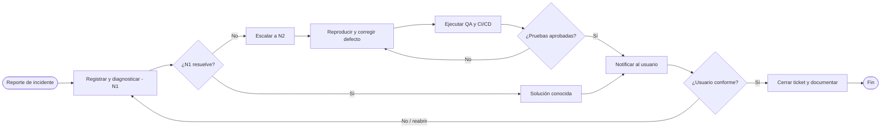

# Vista gráfica complementaria del proceso

> **Esta vista sirve para lectura rápida y no sustituye la notación BPMN del archivo editable.** El XML BPMN debe abrirse y diagramarse en un modelador antes de presentar la evidencia final.

## Roles
- **Usuario/Cliente:** origina el reporte y valida la resolución.
- **Mesa de ayuda N1:** triaje, diagnóstico, solución conocida y cierre.
- **Soporte N2:** análisis y corrección de defectos.
- **QA y CI/CD:** pruebas y validación de cambios antes de informar solución.

Las decisiones de modelado son propuestas académicas, no pasos ejecutados por un software productivo.
